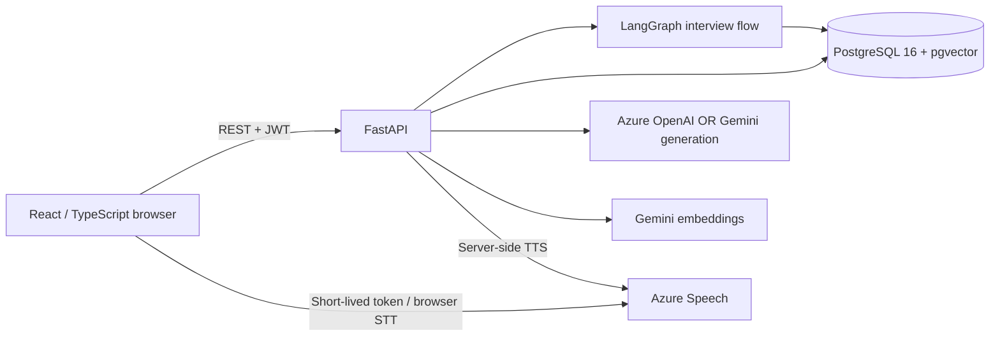

# PrepMate

PrepMate is an AI interview preparation platform that connects resume analysis,
technical and HR mock interviews, feedback reports, and targeted practice. Its
goal is practical preparation: questions a candidate could encounter in a real
interview, calibrated to their target role and experience.

**Status: active development.** The application is implemented and has automated
regression coverage. It is not presented as production-ready or fully validated
for real-user Voice Mode. See [limitations](#limitations-and-development-status).

## Features

| Area | Implemented behavior |
|---|---|
| Resume Analyzer | PDF upload, target role and optional job description, evidence-aware skill matching, strengths/gaps, suggestions, saved analyses and reuse/history |
| Technical interviews | Role/experience-aware topics, Easy/Medium/Hard, adaptive or mock progression, text answers, answer-aware follow-ups |
| HR / Behavioral interviews | HR-specific questions, follow-ups and a separate evaluation rubric; both Text and Voice modes |
| Evaluation and reports | Persisted turn evaluations, report/topic breakdowns, missed concepts and practice recommendations; unavailable grading is reported explicitly |
| Practice | Targeted questions, progressive hints, reference-answer reveal, coaching, retries and assistance tracking, including report-to-practice navigation |
| Account and workspace | Registration/login, profile/password updates, dashboard and saved resume/interview/practice history |
| Voice | Azure browser STT, backend TTS, editable finalized transcript, explicit Stop & Review → Submit, playback/replay and Text fallback |
| Knowledge retrieval | Versioned Markdown sources, predefined roles/skills, PostgreSQL/pgvector search scoped by role, topic, difficulty and experience |

The current catalog contains 12 predefined roles and 54 canonical skills. A role
alias such as Software Developer resolves to Software Engineer. Bundled sources
are not a shipped database: a new installation needs its own reviewed ingestion.

### Difficulty and interview flow

- **Easy:** mostly short, direct fundamentals; roughly 80% direct and 20% simple applied questions.
- **Medium:** roughly half concepts/comparisons and half common implementation or everyday development scenarios.
- **Hard:** roughly 20% challenging direct questions and 80% practical applied problems. A familiar coding, SQL, debugging or design question can be Hard.

These are flexible interview-wide targets, not per-question rejection quotas.
Freshers receive basic-to-intermediate applied fundamentals. Experienced
candidates get more independent reasoning, implementation choices and useful
trade-offs; every question does not become distributed-systems design.

The generation path combines retrieved facts with reviewed technical families
where useful. Simple direct questions use a lightweight payload. Correctness,
clarity and repetition checks remain; independent deeper challenges belong in
answer-aware follow-ups. Adaptive progression responds to evaluated answers;
mock progression preserves its selected difficulty. If generation is unavailable,
the API preserves an already saved answer/evaluation and exposes an explicit retry.

## Architecture

The backend is a **FastAPI modular monolith**; the frontend is **React 18,
TypeScript and Vite**. SQLAlchemy/Alembic manage PostgreSQL, with pgvector for
knowledge embeddings. LangGraph orchestrates interview turns and follow-ups.



- **Azure OpenAI:** OpenAI-compatible Azure Responses API for the configured generation/evaluation model.
- **Gemini:** an alternative generation provider and the separate embedding integration. Current knowledge uses `gemini-embedding-001` with 768-dimensional vectors.
- **Azure Speech:** the backend holds the subscription key, issues short-lived STT authorization, and synthesizes question audio. Provider keys never belong in Vite variables.

`LLM_PROVIDER` selects one generation provider (`azure_openai` or `gemini`). The
factory does **not** implement the old README's automatic provider-order chain.
Gemini embeddings need a Gemini key even when generation uses Azure OpenAI.

LangGraph uses an in-memory checkpointer, with database session state for recovery.
Interview locks, speech limits and some caches are process-local: use **one backend
worker**. Compose's frontend is a development server. The backend image uses one
non-reloading worker. See the [deployment runbook](docs/deployment.md) for cloud
configuration, database isolation requirements and launch gates.

## Repository structure

```text
backend/
  app/
    core/                 configuration, authentication helpers, limits
    db/                   SQLAlchemy models and database sessions
    integrations/llm/     configured model providers
    modules/
      auth/ resume/ interview/ knowledge/ reports/ practice/ speech/
  alembic/                versioned database migrations
  tests/                  unit, API/integration and synthetic fixtures
  eval_data/              backend evaluation fixtures
  scripts/                backend diagnostics/evaluation and offline test entrypoint
frontend/
  src/                    pages, feature hooks, components, API services, types
  tests/                  Vitest regressions
  package-lock.json       frontend dependency lock
knowledge_base/           source notes and provenance manifest
eval_data/                synthetic retrieval/grader evaluation datasets
scripts/                  ingestion, evaluation, verification and repository checks
docs/                     architecture, API guide and historical verification reports
storage/                  local runtime/evidence; selected reviewed helper source only
docker-compose.yml        development backend, frontend and PostgreSQL services
.env.example              public configuration template, without credentials
```

See [architecture](docs/architecture.md), [API guide](docs/api.md),
[tooling notes](scripts/README.md), and [storage policy](storage/README.md).

## Prerequisites

- Git and a Docker installation with Compose supporting `docker compose` and `up --wait`.
- For native backend development: Python **3.12**, matching the backend image.
- For frontend development: Node.js **24 LTS** is recommended (the frontend image uses Node 24), and npm. This audit's native checks used Node 26; use a runtime compatible with the lockfile.
- A PostgreSQL instance with the **vector** extension. Compose provides `pgvector/pgvector:pg16`.
- Account access to the generation/embedding models you configure. Azure Speech is optional for Text Mode.

The backend image installs `backend/requirements-linux.lock`, a tested Linux /
Python 3.12 snapshot. `requirements.txt` remains the native-development source
constraints. The frontend has a lockfile; use `npm ci`. Regenerate and audit the
Linux lock deliberately during dependency upgrades; it is not a Windows lock.

## Configuration

From the repository root, copy the template and edit `.env`:

```powershell
Copy-Item .env.example .env
```

On POSIX shells use `cp .env.example .env`. Do not commit the populated file.

| Variables | Purpose |
|---|---|
| `POSTGRES_USER`, `POSTGRES_PASSWORD`, `POSTGRES_DB` | Compose database initialization; replace development placeholders |
| `DATABASE_URL` | SQLAlchemy `postgresql+psycopg` URL; host `db` inside Compose, `127.0.0.1` for a native backend |
| `APP_ENV`, `CORS_ORIGINS` | Runtime environment and JSON list of exact frontend origins; production requires public HTTPS origins and TLS PostgreSQL |
| `DB_POOL_SIZE`, `DB_MAX_OVERFLOW`, `DB_POOL_TIMEOUT`, `DB_CONNECT_TIMEOUT` | Bounded pool (default 5 + 5) and 10-second pool/connect deadlines |
| `JWT_SECRET_KEY` | Required non-placeholder secret of at least 32 bytes; startup rejects an empty/weak placeholder |
| `JWT_ALGORITHM`, `ACCESS_TOKEN_EXPIRE_MINUTES` | Current JWT configuration: HS256; template expiry is 15 minutes |
| `LLM_PROVIDER` | `azure_openai` or `gemini` |
| `AZURE_OPENAI_API_KEY`, `AZURE_OPENAI_ENDPOINT`, `AZURE_OPENAI_MODEL` | Azure credentials, Responses API endpoint and accessible model/deployment name |
| `GEMINI_API_KEY`, `GEMINI_MODEL` | Gemini embeddings, and generation when selected; verify model availability for your account |
| `EMBEDDING_MODEL`, `EMBEDDING_DIMENSIONS` | Existing corpus configuration: `gemini-embedding-001`, `768`; changing these requires reviewed re-embedding |
| `LLM_TIMEOUT_SECONDS` | Provider HTTP timeout; some generation paths impose a shorter shared model deadline |
| `AZURE_SPEECH_KEY`, `AZURE_SPEECH_REGION` | Optional Voice Mode resource configuration; credentials remain backend-only |
| `VITE_API_URL` | Public frontend backend URL; defaults to `http://localhost:8000` in Compose |

The frontend also recognizes `VITE_API_BASE_URL` with higher priority. Its only
configuration should be public browser settings. `AZURE_SPEECH_ENDPOINT` is a
declared backend setting but the current speech service derives URLs from the
region; it is not a documented endpoint-override feature.

The template's model names reflect code defaults, not a promise of provider access.
Older `JWT_SECRET`, `JWT_EXPIRE_MINUTES`, and `LLM_PROVIDER_ORDER` names are not the
active settings. Langfuse and daily-token-cap template entries were removed because
they do not configure implemented behavior.

## Run with Docker Compose

After filling `.env`, run from the repository root:

```sh
docker compose up -d --wait db
docker compose build backend
docker compose run --rm --no-deps backend alembic upgrade head
docker compose up --build -d backend frontend
docker compose ps
```

Migrations are an explicit step; the backend startup command does not apply them.
The initial migration installs pgvector, so the migration user needs appropriate
extension privileges. Do not run migrations against a database you did not intend
to change. Changing database initialization variables does not rewrite credentials
in an existing PostgreSQL volume.

- Frontend: [localhost:5173](http://localhost:5173)
- Backend health: [localhost:8000/health](http://localhost:8000/health)
- Database readiness: [localhost:8000/health/ready](http://localhost:8000/health/ready)
- Interactive OpenAPI: [localhost:8000/docs](http://localhost:8000/docs)

Register an account, upload a PDF for a target role, and start a Technical or HR
interview. A health response confirms the app is serving, not that every external
AI/Speech resource is configured or funded.

### Knowledge preview and ingestion

Source notes are versioned; database rows and embedding caches are local. Preview
the intended scope first:

```sh
docker compose exec -T backend python -m app.modules.knowledge.ingest_cli --root /app/knowledge_base/software_engineering
```

Preview is read-only and does not request embeddings. Applying an ingestion plan
requires its explicit reviewed approval token and can incur embedding charges.
This example is folder-scoped: it includes every role assigned by those files,
not just Software Engineer, and is not approval for a historical role-only rollout.
Do not run the broader corpus apply merely to reproduce a historical rollout.
See [knowledge format, attribution and apply procedure](knowledge_base/README.md).
Retrieval may have no context until appropriate knowledge is ingested.

## Native development

From the root, create the backend environment (PowerShell):

```powershell
py -3.12 -m venv .venv
.\.venv\Scripts\python.exe -m pip install -r backend/requirements.txt
```

For a native backend, set `DATABASE_URL` to your local PostgreSQL host
(`127.0.0.1`, not Compose's `db`), with URL-encoded credentials. Then:

```powershell
Set-Location backend
..\.venv\Scripts\python.exe -m alembic upgrade head
..\.venv\Scripts\python.exe -m uvicorn app.main:app --host 127.0.0.1 --port 8000 --reload
```

In a second terminal from the root:

```powershell
Set-Location frontend
Copy-Item .env.example .env
npm ci
npm run dev
```

POSIX equivalents use `python3.12 -m venv .venv` and `.venv/bin/python` (or
`../.venv/bin/python` from `backend`). Keep one serving backend worker. The current
CORS list permits `localhost:5173` and `127.0.0.1:5173`; other origins require an
explicit `CORS_ORIGINS` configuration.

## Tests and build

For the complete offline backend suite, including actual PostgreSQL/pgvector
tests and fresh migrations, use the disposable runner from the root after building
the backend image. It needs no private database backup or paid API calls:

```powershell
docker compose build backend
.\.venv\Scripts\python.exe scripts/test_backend_isolated.py --image ai-interview-coach-backend:latest
```

The runner creates its own PostgreSQL container/network with synthetic credentials,
blocks external HTTP transports, runs migrations/tests and removes only the
resources it created. Results are written under ignored
`storage/repository-sync/backend-tests/`. It does not connect to the existing
application database. Source mounts are read-only.

For ordinary native tests, from `backend`:

```powershell
..\.venv\Scripts\python.exe -m pytest tests -q
```

PostgreSQL-specific tests are opt-in and will skip unless explicitly configured.
Use the isolated runner for them; do not point the opt-in flags at a production
database. Tests that deliberately construct model providers need synthetic
configuration; the runner supplies it and blocks network access.

From the root for tooling tests:

```powershell
$env:PYTHONPATH = "backend"
.\.venv\Scripts\python.exe -m pytest scripts/tests -q
```

From `frontend`:

```sh
npm test
npm run build
```

Model evaluations under `scripts/` and `backend/scripts/` are separate from
regressions. Some make paid requests, depend on a running app, or require frozen
local artifacts. Read [tooling notes](scripts/README.md) before executing them.

## Voice status

The code implements explicit recording start, Stop & Review, transcript editing,
separate submission, token renewal, playback cancellation/replay and Text fallback.
Speech endpoints require authentication; the subscription key stays on the backend.

Historical tests exercised real Azure STT/TTS with prerecorded browser microphone
input for Technical and HR interviews. **Physical microphone capture and human
listening acceptance remain unverified.** This is not a claim of completed live
human voice acceptance. See [verification steps](docs/voice-mode-verification.md),
[historical acceptance](docs/voice-mode-acceptance-report.md), and
[subsequent blocker fixes](docs/voice-release-blocker-fixes.md).

## Limitations and development status

- Generated questions, resume feedback and grades can be wrong or ambiguous. The quality screen still makes false rejections; reports disclose unavailable grading rather than inventing scores.
- The single-process locking, rate-limit and checkpoint configuration has not been validated as a distributed/multi-worker deployment.
- Unsaved answer drafts and active audio state are temporary; saved session state is the recovery boundary.
- Fresh installs do not include private users, the development knowledge database, evaluation vectors or cached provider receipts.
- Camera/strict-mode components, tracing and background-task files include scaffolds; they are not advertised as implemented features.
- No production deployment, comprehensive load/security certification or full real-user microphone acceptance is claimed.

[Current question-policy verification](docs/practical-interview-difficulty.md)
and [historical reports](docs/README.md) distinguish mocked, database and real-provider
checks. Reports may reference private local evidence that is intentionally not
published; those artifact links are not public verification downloads.

## Repository hygiene

Commit application code, migrations, tests, synthetic fixtures, scripts, knowledge
sources and useful documentation. Keep populated environment files, candidate data,
database exports, generated embeddings, audio and local evidence out of Git.

Before a proposed commit:

```sh
git diff --cached --check
python scripts/scan_staged_secrets.py
```

The scan checks exact staged blobs for known credential shapes and current local
credential values without printing those values. It complements manual review;
it is not a full history or PII certification. See [storage policy](storage/README.md).
The application has no repository-wide license declaration; knowledge notes have
their own documented attribution and licensing scope.
